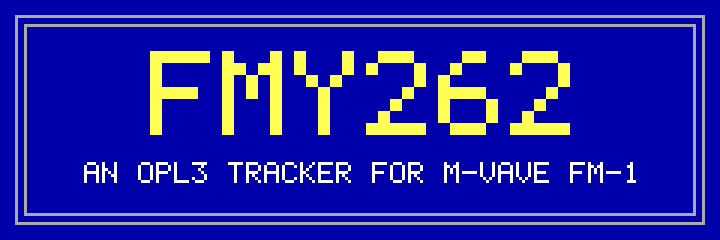

<b></b>M-VAVE FM-1용 OPL3(YMF262) 트래커<b></b> — 커스텀 펌웨어, 만든 이 Mr. Tracy Evans.

<b><a href="https://jpark-spec.github.io/fmy262/#install">브라우저에서 설치하기</a></b> · <a href="https://jpark-spec.github.io/fmy262/#songs">곡 (USB, A2M / RAD 가져오기)</a> · <a href="https://jpark-spec.github.io/fmy262/#run">브라우저에서 실행해 보기</a> 
<a href="../../releases">릴리스</a> · <a href="CHANGELOG.md">변경 기록</a> · <a href="#빌드">빌드</a> · <a href="LICENSE">라이선스 (GPL-2.0)</a> · <a href="README.md">English</a>

---

FMY262는 FM-1을 Adlib Tracker II 방식의 18채널 OPL3 트래커로 바꿉니다. 패턴, 2·4 오퍼레이터 악기, 퍼커션 모드,
AT2 이펙트와 매크로를 FM-1의 240×240 화면·노브·버튼·27건반으로 다룹니다. 워크벤치 웹 페이지에서 설치하고,
USB로 곡을 주고받고, Adlib Tracker II·Reality AdLib Tracker 곡을 가져오고, 펌웨어 자체를 브라우저에서 돌려 볼 수
있습니다.

> **커스텀 펌웨어이므로 사용은 본인 책임입니다.** M-VAVE가 만들거나 지원하는 것이 아닙니다. 워크벤치의 설치 페이지로
> M-VAVE 순정 펌웨어(파일은 M-VAVE에서 받아야 함)로 되돌릴 수 있지만, 여느 펌웨어처럼 설치 실패의 가능성은 있습니다.

## 받기

[최신 릴리스](../../releases/latest)에서:

| 파일 | 내용 |
|---|---|
| `fmy262-VERSION.fwsc` | 펌웨어 패키지만 따로(zip 안의 것과 같은 파일; The Firmware Hub가 설치하는 것) |
| `fmy262-VERSION.zip` | `fmy262-VERSION.fwsc`(펌웨어 패키지), `fmy262-workbench-VERSION.html`(곡 페이지 한 파일), `fmy262-prototype-VERSION.html`(브라우저 프로토타입: 그려진 FM-1 위의 트래커 전체), 라이선스·변경 기록 |
| `fmy262-workbench-site-VERSION.zip` | 워크벤치 사이트(이 저장소의 GitHub Pages에도 올라감) |

**워크벤치**([jpark-spec.github.io/fmy262](https://jpark-spec.github.io/fmy262/); 탭마다 주소 `#run`·`#songs`·`#install`·`#help`) 탭: **실행**(브라우저에서 도는 FMY262 펌웨어), **곡**(에뮬레이터 또는 USB로 연결한 FM-1의 슬롯 4개 —
`.a2m`·`.rad`(1.0/2.1)·`.fmy` 가져오기, `.a2m`·`.fmy`로 저장), **펌웨어 설치**(Chrome·Edge의 WebSerial로
설치, 순정으로 되돌리기), **도움말**.

**다른 펌웨어에서 올 때:** FMY262는 다른 펌웨어의 프로젝트·프리셋·샘플을 읽지 못하고, 곡 슬롯과 설정이 다른
펌웨어가 저장에 쓰던 플래시 자리를 쓸 수 있다. 먼저 백업할 것(설치 탭이나 쓰던 펌웨어의 백업). 다른 펌웨어로
돌아가는 것은 설치 탭이나 어느 설치기로든 되고, FMY262 곡은 다른 펌웨어가 덮어쓰기 전까지만 플래시에 남으니
곡 탭에서 `.fmy`·`.a2m` 파일로 받아 둘 것.

## 조작 요약

- **패턴**: SELECT 위아래, 노브1 패턴, 노브2 채널, ALGORITHM 좌우, 노브3 이펙트, 노브4 값. 건반은 커서 칸의 음을
  바꿈(REC 켜면 넣고 내려감). EDIT 지우기, PRESETS 악기. HOME 짧게 = 3채널 → 9채널 → 파형 1 → 파형 9
- **블록**: HOME+노브1/2 범위, 노브3 이조, HOME+OCT−/+ 복사·붙여넣기
- **ENV**: 악기 4쪽, ALGORITHM = FM/ADD/4OP 연결, SEL = 오퍼레이터
- **ARP** 아르페지오 → 비브라토 → FM 레지스터 매크로, **SEQ** 곡 순서, **GLO** 템포·칩·보이스
- **HOME+GLO** 파일(슬롯 4개), **SAVE** 저장
- **PLAY**: 어느 화면에서든 재생/정지(HOME+PLAY 패턴 반복). **HOME 길게**: 설정, INFO(라이선스)

## 빌드

`npm ci && npm run build`(웹 페이지), `npm test`(테스트), `tools/fetch-vendor.sh` 후 fm1-base의 툴체인 준비 →
`npm run workbench`(펌웨어·워크벤치), `tools/release.sh VERSION`(릴리스). 자세한 설계 메모는 `CLAUDE.md`.

## 라이선스

GPL-2.0-or-later(`LICENSE`). 다른 사람의 코드와 따른 파일 형식은 `NOTICE.md`.
